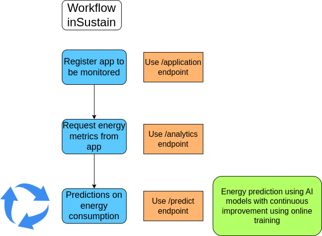
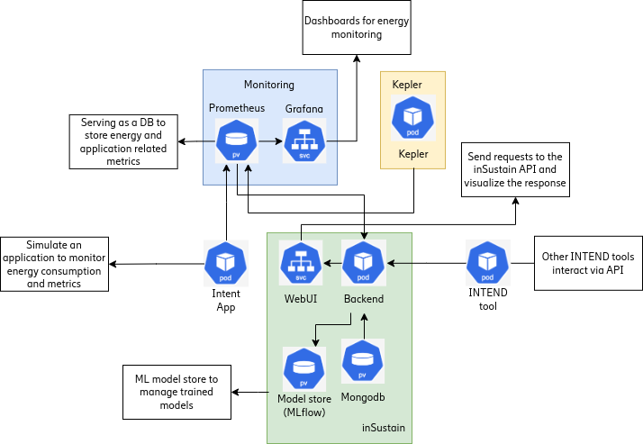

# inSustain - A tool of the INTEND project

InSustain provide estimated energy metrics for cloud native deployments. The erngy metrics can be queried using our API or the webservice UI. Prediction of energy metrics is under development but it will be available soon. 

# Pre-requisites

- Kubernetes cluster v1.30.6+
- HELM v3.17.1+
- prometheus-operator v0.80+ (or any other equivalent Prometheus server)
- [Kepler](https://sustainable-computing.io/) v0.8

# Prometheus installation

We recommend the Kube Prometheus Stack helm chart, which includes the Node Exporter, Grafana and other helpful stuff to provide easy to operate end-to-end Kubernetes cluster monitoring with Prometheus using the Prometheus Operator.

```bash
helm repo add prometheus-community https://prometheus-community.github.io/helm-charts
helm repo update

helm install monitoring prometheus-community/kube-prometheus-stack \
    --namespace monitoring \
    --wait
```

# Kepler installation
We also recommend installing the Kepler chart on the monitoring namespace.

```bash
helm repo add kepler https://sustainable-computing-io.github.io/kepler-helm-chart
helm install kepler kepler/kepler --version 0.8.0 --set serviceMonitor.enabled=true\
    --set serviceMonitor.labels.release=monitoring \
    --namespace monitoring \
    --wait
```

# Install inSustain

Since inSustain is a proprietary tool we are not hosting a public repository with the docker images. So the images are usually hosted on a Docker repository on the premises of the use case.

Additionally since inSustain must monitor pods on possible other namespaces it requires a Service Account binded to a ClusterRole to list and discover pods.

If there is already a prometheus server installed with a different release name then  inSustain can use this deployment by setting the value of the release name in the HELM installation using --set global.monitoring.labels.release=<prometheus-release-name>

The custom Docker repository id can be set using --set global.image.repository=<repository-url>, a prefix can also be added using --set global.image.prefix=<prefix>.

For a more detailed description of all the installation options please see our values.yaml file [here](insustain/values.yaml)

```bash
helm install <helm-chart-name> insustain-1.0.0.tgz --create-namespace --namespace insustain --set backend.enabled=true
```

# inSustain workflow

The workflow of the inSustain application is represented on the following diagram


# Architecture
This is an architecture example of the inSustain application
