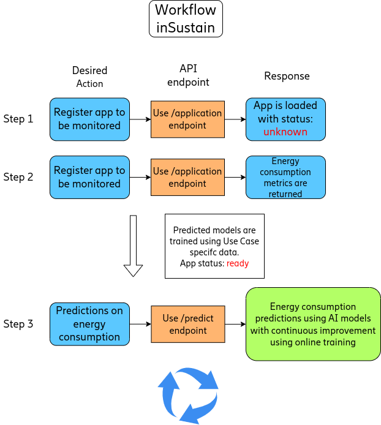
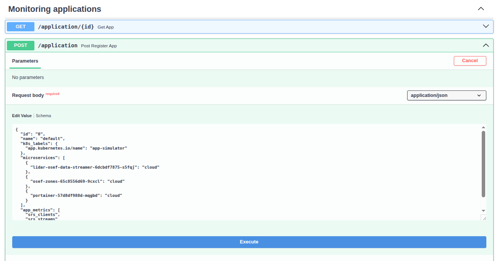
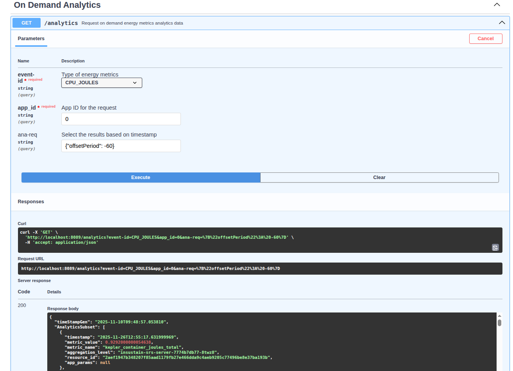
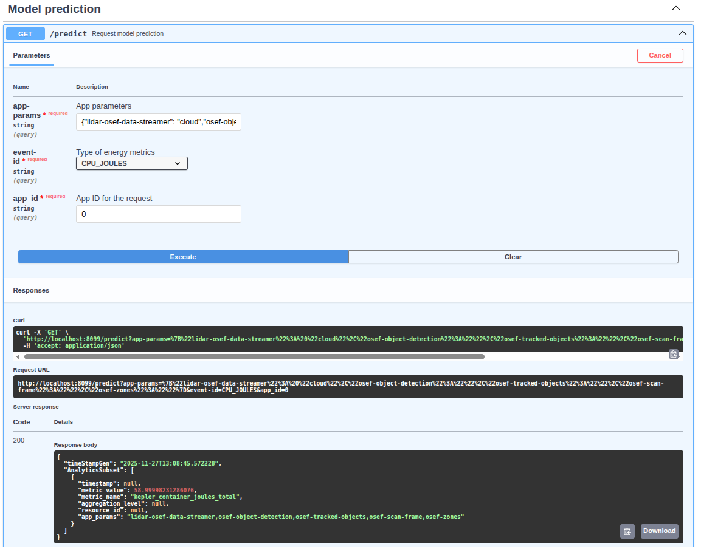
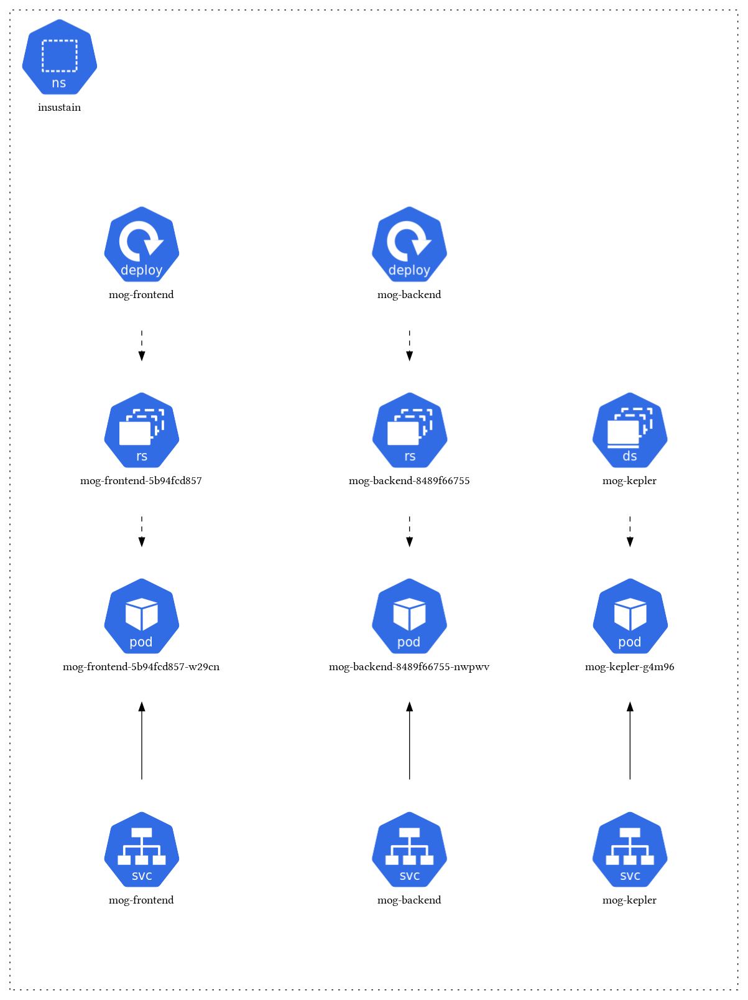

# inSustain - A tool of the INTEND project

InSustain provide estimated energy metrics for cloud native deployments. The erngy metrics can be queried using our API or the webservice UI. Prediction of energy metrics is under development but it will be available soon. 

# Pre-requisites

- Kubernetes cluster v1.30.6+
- HELM v3.17.1+
- prometheus-operator v0.80+ (or any other equivalent Prometheus server)
- [Kepler](https://sustainable-computing.io/) v0.7+ (Installed with inSustain)

# Prometheus installation

We recommend the Kube Prometheus Stack helm chart, which includes the Node Exporter, Grafana and other helpful stuff to provide easy to operate end-to-end Kubernetes cluster monitoring with Prometheus using the Prometheus Operator.

```bash
helm repo add prometheus-community https://prometheus-community.github.io/helm-charts
helm repo update

helm install prometheus prometheus-community/kube-prometheus-stack \
    --namespace monitoring \
    --create-namespace \
    --wait
```

# Pulling inSustain Docker images

We provide a minimal docker repository with TLS security to download the inSustain images. The procedure to download the images is:

Download the [docker_cert](certs/docker_ca.crt) and add them into the directory necessary to login into our docker repository. For instance in ubuntu the appropiate directory is 

## Download the certs

```bash
sudo mkdir -p /etc/docker/certs.d/89.133.95.6:5001
sudo cp docker_cert /etc/docker/certs.d/89.133.95.6:5001
sudo chmod 600 /etc/docker/certs.d/89.133.95.6:5001/*
```

## Restart the docker service using

```bash
sudo systemctl restart docker
```

## Authenticate
Once the certificates have been placed on the appropiate directory and the docker service has been restarted then login can be attempted using the credentials provided (via email)

```bash
docker login 89.133.95.6:5001 -u intend -p <password>
```

## Obtain docker images
Once login is successful images can be downloaded from the repository. For instance to a minimal installation of the inSustain tool the backend iamge is necessary and can be downloaded using the command:

```bash
docker save 89.133.95.6:5001/insustain/backend:latest -o backend.tar
```

## Import into K3s/K3s nodes
Finally, the docker image can be imported into the K8s/K3s server nodes available for pod deployment. For instance, using the following command:

```bash
sudo k3s ctr images import backend.tar
```

# Install inSustain

To install inSustain first download the helm chart from a release on this repository:

```bash
curl "https://github.com/INTEND-Project/InSustain/releases/download/v1.2.0/insustain-1.2.0.tgz" -o insustain-1.2.0.tgz
```

## Install the HELM chart
Using the standard HELM chart downloaded on the previous step
```bash
helm install <helm-chart-name> insustain
```
If there is already a prometheus server installed in a different namespace then inSustain can use this deployment by setting the following values in the HELM installation

```bash
helm install <helm-chart-name> insustain --create-namespace --namespace insustain --set backend.enabled=true --set frontend.enabled=true --set kepler.enabled=true --set prometheus.namespace= <prometheus-namespace> --set prometheus.servceName=<prometheus-name>
```

## Inspecting the pods
When the inSustain deployment is freshly deployed in it's minimal setting the number of pods deployed are the following
```bash
eamrerp@node0:~$ kubectl -n insustain get po
NAME                                 READY   STATUS    RESTARTS   AGE
insustain-backend-7b7d478bf4-4c94k   1/1     Running   0          15d
insustain-mlflow-dc947d47c-n7zs5     1/1     Running   0          26d
insustain-mongodb-7dccc85cf5-jjdb9   1/1     Running   0          20d
minio-86b9854bb7-hrzll               1/1     Running   0          26d
postgres-5b74ddb865-f44xb            1/1     Running   0          26d
```

The pods should be running and saving the data in-memory, unless PVCs have been specified during the helm chart installation.

The inSustain services can be accessed by port-forwarding the K8s services.

```bash
eamrerp@node0:~$ kubectl -n insustain get svc
NAME                TYPE        CLUSTER-IP       EXTERNAL-IP   PORT(S)
insustain-backend   ClusterIP   10.103.3.30      <none>        8089,8888,8887
insustain-mlflow    ClusterIP   10.106.197.231   <none>        5000
insustain-mongodb   ClusterIP   10.111.184.183   <none>        27017
minio               ClusterIP   10.99.113.1      <none>        9000
minio-console       ClusterIP   10.109.170.253   <none>        9001
postgres            ClusterIP   10.99.187.189    <none>        5432
```

For instance to access the inSustain API it is necessary to port-forward the port 8089 of the backend service using the command

```bash
kubectl -n insustain port-forward svc/insustain-backend 8089:8089
```

Then the API would be available on http://localhost:8089/docs


# Application monitoring workflow
This is a diagram of the lifecycle of application monitoring using inSustain


## Registering an application
To register a new application it can be done using the endpoint /application using the POST request. For instance, here is an screenshot of an example of an application encompasing three microservices on the GATE UC.
The necessary parameters are application-id and name. While the application metadata is optional but it will influence the status of the application. Applications without proper metadata are not suitable to have prediction models available for prediction


## Obtaining metrics from a registered application
To obtain the estimated energy metrics from a previously registered application we can use the _/analytics_ endpoint of the backend service. You can choose the metric type that you are trying to request data from. The current available values are CPU_JOULES, DRAM_JOULES, BPF_CPU_TIME_US, CPU_CYCLES. It is also mandatory to specify your application id, and an offset period in minutes. Meaning minutes before the current time in the example shown is 60 minutes. Only negative values are allowed.


## Obtain predictions from the API

If your application has sufficient metadata then predictive models will be automatically trained by the inSustain tool. Once the models have been trained then the status of the application will change from _unknown_ to _ready_ if the training was successful. After this training time then predictions can be requested using the endpoint _/predict_.
To obtain energy predictions the application parameters and values have to be provided. These application parameters must coincide with the parameters provided during the application registration. We provide an example of a predict request to the previously registered application.


# Architecture
This is an architecrure diagram of the services deployed by inSustain adn their interaction with applications to be monitored and other INTEND tools.
